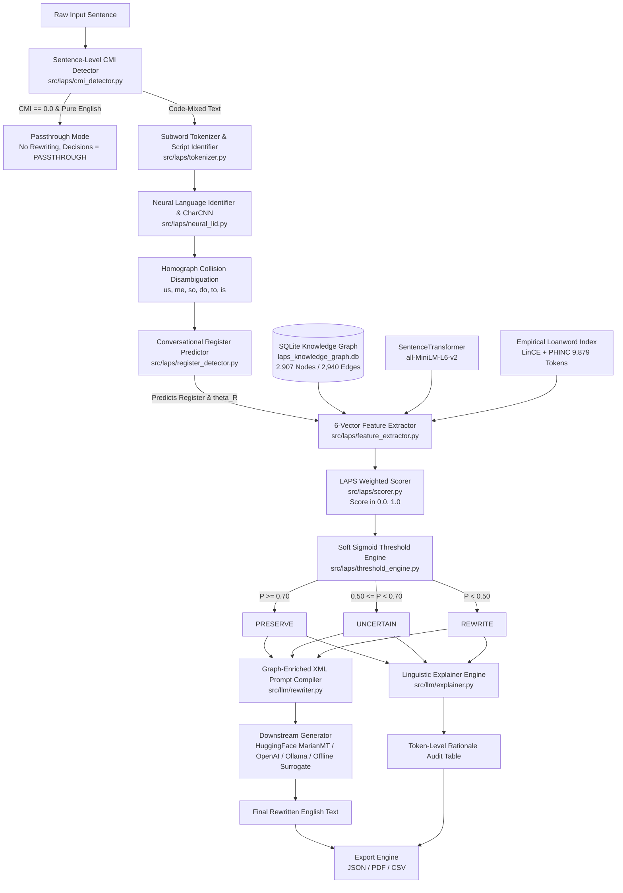

# LAPS Architecture and Data Flow Specification

**Project Title:** LAPS — Linguistic Adaptive Preservation Scoring for Explainable Token-Level Decision Making in Code-Mixed Text Rewriting  
**Course:** BCSE497J — Project-I, Vellore Institute of Technology, Vellore  
**Document:** `docs/architecture_and_data_flow.md`  

---

## 1. System Overview

LAPS is an **upstream, pre-generation neuro-symbolic guardrail architecture**. It evaluates code-mixed sentences *prior* to sequence generation, resolving candidate loanwords, assessing linguistic features across six orthogonal dimensions, computing continuous preservation probabilities through a communicative-register-modulated Soft Sigmoid boundary, and emitting machine-parseable XML constraints along with human-auditable explanations.

---

## 2. End-to-End Execution Pipeline

The complete flow from user input to rewritten output proceeds through eight coordinated stages:



---

## 3. Detailed Module Specifications

### 3.1 Sentence-Level CMI Detector (`src/laps/cmi_detector.py`)
- **Purpose:** Determines the global language composition of the input sentence and prevents unnecessary rewriting of pure English text.
- **Formulation:** Gambäck & Das (2014) Code-Mixing Index:
  $$\text{CMI} = 100 \cdot \left[1 - \frac{\max(N_{\text{lang}})}{N_{\text{total}}}\right]$$
- **Inputs:** Raw input string `sentence`.
- **Outputs:** Dictionary containing `mode` (`MONOLINGUAL_EN`, `MONOLINGUAL_HI`, `CODE_MIXED`), `cmi` (float $0.0\text{--}50.0$), `en_ratio`, `hi_ratio`, and posterior probability averages.
- **Fallback Behavior:** If no alpha tokens exist, returns `MONOLINGUAL_EN` with $\text{CMI}=0.0$. If Hindi marker count is zero and Devanagari is absent with $P(\text{HI}) < 0.15$, marks sentence as `MONOLINGUAL_EN`.

### 3.2 Tokenizer & Script Identifier (`src/laps/tokenizer.py`)
- **Purpose:** Segment text into tokens, identify character scripts (Latin, Devanagari, punctuation), and filter non-candidate words.
- **Inputs:** String `text`.
- **Outputs:** List of dictionaries `[{"token": str, "lower": str, "script": str, "language": str, "is_candidate": bool, ...}]`.
- **Key Logic:** Disambiguates closed-class grammatical collisions (`AMBIGUOUS_HINDI_EN_COLLISIONS` like *us, me, so, do, to, is*) using context cues, mapping them to Hindi native particles (`is_candidate = False`).

### 3.3 Neural Language Identifier (`src/laps/neural_lid.py`)
- **Purpose:** Provide robust subword language identification for noisy Romanized Hindi text.
- **Model:** 
  1. Character-level Convolutional Neural Network (`CharCNN`) trained on Latin-script Hindi and English tokens (`data/models/char_lid.pt`).
  2. Subword character n-gram profiles (`HINDI_CHAR_NGRAMS`, `ENGLISH_CHAR_NGRAMS`, orders 2, 3, 4).
  3. Phonetic transliteration normalizer (`normalize_phonetic_transliteration`) resolving informal chat spellings (*smjh $\to$ samajh, cl $\to$ kal, plzz $\to$ please*).
- **Outputs:** Continuous calibrated posteriors $P(\text{HI} \mid t)$ and $P(\text{EN} \mid t)$.

### 3.4 Conversational Register Predictor (`src/laps/register_detector.py`)
- **Purpose:** Automatically infer communicative register and formality threshold $\theta_R$.
- **Registers & Formality Thresholds:**
  - `casual` ($\theta_R = 0.35$): Informal messaging, WhatsApp, chat contractions.
  - `social` ($\theta_R = 0.40$): Public social commentary, tweets.
  - `business` ($\theta_R = 0.50$): Professional workplace, Slack/Teams, engineering communication.
  - `academic` ($\theta_R = 0.65$): Formal academic reports, research papers, viva, thesis.
- **Inputs:** Input string `text`.
- **Outputs:** `{"predicted_register": str, "threshold": float, "confidence": float, "cue_counts": dict}`.

### 3.5 Feature Extractor (`src/laps/feature_extractor.py`)
- **Purpose:** Extract 6 linguistic feature signals $\in [0.0, 1.0]$ for each candidate token:
  1. **BF (Borrowing Frequency):** Derived from `empirical_loanword_index.json` (16,024 LinCE/PHINC sentences); falls back to continuous Zipf frequency via `wordfreq`.
  2. **DS (Domain Specificity):** Cosine similarity between candidate contextual embedding (`all-MiniLM-L6-v2`) and 5 domain centroid prototypes (Tech, Business, Academic, Medical, Finance).
  3. **SI (Semantic Importance):** Information Content (negative log frequency proxy) combined with morphological derivational affix bonuses.
  4. **CC (Context Consistency):** Knowledge Graph context co-occurrence PMI combined with context-window loanword density.
  5. **AF (Audience Familiarity):** Cross-lingual recognition index normalized from Zipf distribution.
  6. **TB (Translation Benefit):** Syntactic functional role analysis; high ($0.75\text{--}0.85$) for action verbs and modal modifiers, low ($0.15\text{--}0.20$) for nominal domain entities.

### 3.6 Knowledge Graph Engine (`src/laps/graph_engine.py`)
- **Purpose:** Connects to `data/vocabulary/laps_knowledge_graph.db` (2,907 nodes, 2,940 edges).
- **Queries:**
  - `get_node_attributes(token)`: Fetches frequency, domain, borrowing ratio, reverse borrowing flag.
  - `get_en_to_hi_edge(token)`: Fetches translation `naturalness_penalty` and `meaning_drift`.
  - `get_context_cooccurrence(token, context)`: Evaluates co-occurrence edge weights in SQLite.

### 3.7 Scorer & Threshold Engine (`src/laps/scorer.py`, `src/laps/threshold_engine.py`)
- **Preservation Score:**
  $$\text{Score}(t) = \sum_{j=1}^{5} w_j \cdot f_j(t) - w_6 \cdot \text{TB}(t)$$
- **Soft Sigmoid Probability Boundary:**
  $$P(\text{Preserve} \mid t, \theta_R) = \sigma(\lambda \cdot (\text{Score}(t) - \theta_R)) = \frac{1}{1 + e^{-\lambda(\text{Score} - \theta_R)}}$$
  where $\lambda = 10.0$ and $\theta_R \in \{0.35, 0.40, 0.50, 0.65\}$.
- **Ego-Density Modulation:**
  $$\Delta_{\text{ego}} = (\text{CC}_{\text{ego}} - 0.50) \cdot 0.10, \quad P_{\text{adj}} = \text{clip}(P + \Delta_{\text{ego}}, 0.0, 1.0)$$
- **Three-Zone Decision Mapping:**
  - $P_{\text{adj}} \ge 0.70 \implies \textbf{PRESERVE}$
  - $0.50 \le P_{\text{adj}} < 0.70 \implies \textbf{UNCERTAIN}$ (preserved, with audit notice)
  - $P_{\text{adj}} < 0.50 \implies \textbf{REWRITE}$ (eligible for translation)

### 3.8 XML Prompt Compiler & Rewriter (`src/llm/rewriter.py`)
- **Purpose:** Compiles token decisions and domain metadata into valid, structured XML:
  ```xml
  <rewrite_task source_language="Hinglish" target_language="English" register="business">
    <input_sentence>Kal client meeting postpone ho gayi</input_sentence>
    <preservation_constraints>
      <token name="meeting" action="PRESERVE" domain="Business" naturalness_penalty="0.85">
        Do not translate 'meeting' (professional business or corporate context).
      </token>
    </preservation_constraints>
    <instruction>Rewrite in formal, professional business English...</instruction>
  </rewrite_task>
  ```
- **Constraint Enforcement:** Dispatches to local MarianMT NMT model (`force_words_ids`), remote LLMs (via XML instruction guidance), or offline surrogate.

### 3.9 Explainer & Report Exporter (`src/llm/explainer.py`, `src/laps/exporter.py`)
- **Purpose:** Formulates token-level human-auditable linguistic justifications explaining why each decision was made, and exports complete structured audit reports to JSON, PDF, and CSV formats.

---

## 4. Execution Data Flow Table

| Stage | Input Data | Transformation | Output Data |
| :--- | :--- | :--- | :--- |
| **Stage 1** | Raw text string | CMI detection via Gambäck-Das formula | Language mode, CMI percentage |
| **Stage 2** | Text string | Regular expression & Unicode script check | Tagged token array |
| **Stage 3** | Latin tokens | CharCNN + character n-gram posterior calculation | Posterior probabilities $P(\text{HI}), P(\text{EN})$ |
| **Stage 4** | Full utterance | Lexical marker aggregation & count weighting | Register $R$ and threshold $\theta_R$ |
| **Stage 5** | Candidate tokens | MiniLM embeddings + SQLite KG queries + Zipf | 6-dimensional feature vector per token |
| **Stage 6** | Feature vectors | Linear combination with register weight vector | Composite score $\in [0.0, 1.0]$ |
| **Stage 7** | Composite scores | Logistic sigmoid + KG ego-density modulation | Preservation probability $P \in [0.0, 1.0]$ & decision |
| **Stage 8** | Decisions + Sentence | XML generation + Model inference | Rewritten text + Rationale table + Export |

---

## 5. Error Handling and Degradation Strategy

1. **Missing PyTorch / CUDA:** Automatically falls back to CPU execution or subword n-gram Bayesian fallback without crash.
2. **Missing Remote API Key:** Gracefully uses local MarianMT NMT model or offline surrogate; records active backend in audit metadata.
3. **Empty or Whitespace-Only Input:** Handled cleanly with empty candidate list and zero score.
4. **Out-of-Vocabulary (OOV) Tokens:** Handled via continuous Zipf distribution and MiniLM zero-shot cosine similarity; never crashes on novel technical vocabulary.
5. **Database Disconnection:** Catches SQLite exceptions and substitutes safe neutral priors ($0.50$).
