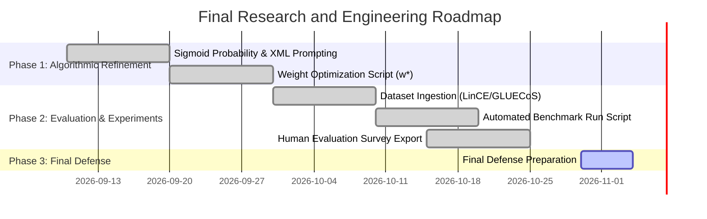

# LAPS Final Phase Research and Engineering Blueprint
## A Senior NLP Researcher's Specification for Publication-Grade Token Preservation in Code-Mixed Rewriting

> **Author:** LAPS Core Engineering & Research Group  
> **Target Venues:** IEEE/ACM Transactions on Audio, Speech, and Language Processing (TASLP), EMNLP, ACL, and US/Indian Patent Specification Filing.  
> **Scope:** Final Implementation Phase.

---

## 1. Executive Summary and Research Philosophy

Modern Multilingual Large Language Models (LLMs) treat code-mixed text rewriting as an unconstrained text-to-text generation task. This black-box paradigm suffers from **lexical over-translation**, replacing natural loanwords (*meeting*, *client*, *server*, *viva*, *link*) with rigid monolingual equivalents.

The **LAPS (Linguistic Adaptive Preservation Scoring)** framework introduces an explicit, pre-generation linguistic decision layer. While the initial phase established the **Bilingual Code-Mixed Knowledge Graph (2,907 nodes, 2,940 edges)**, **Sentence-Level CMI Tagger**, and **Interactive Streamlit Interface**, the advanced phase focuses on **mathematical rigor, empirical optimization, automatic benchmarking, and double-blind human evaluation**.

---

## 2. Advanced Mathematical Formulation

### 2.1 Soft Sigmoid Logistic Preservation Probability
In place of rigid step thresholds ($\text{Score} \ge \theta$), LAPS models preservation as a smooth logistic probability distribution over the scoring landscape:

$$P(\text{Preserve} \mid t_i, C, \theta_R) = \sigma\left( \lambda \cdot (\text{LAPSScore}(t_i, C) - \theta_R) \right) = \frac{1}{1 + e^{-\lambda (\text{LAPSScore}(t_i, C) - \theta_R)}}$$

Where:
* $t_i$: Target candidate token.
* $C$: Local sentence context window ($t_{i-2}, \dots, t_{i+2}$).
* $\theta_R$: Dynamic threshold for communicative register $R \in \{\text{Casual: 0.35}, \text{Social: 0.40}, \text{Business: 0.50}, \text{Academic: 0.65}\}$.
* $\lambda$: Steepness parameter ($\lambda = 10.0$), controlling boundary sensitivity.

### 2.2 Knowledge-Graph Ego Density ($\text{CC}_{\text{ego}}$)
Context Consistency ($\text{CC}$) is computed via $k$-hop sub-graph density within the Bilingual Knowledge Graph $G = (V, E)$:

$$\text{CC}_{\text{ego}}(t_i, C) = \frac{|\{(u, v) \in E \mid u, v \in C \cup \{t_i\}\}|}{\binom{|C| + 1}{2}}$$

This measures whether surrounding tokens form a dense semantic cluster with $t_i$ inside professional or technical domains.

---

## 3. Automated Weight Vector Optimization ($\mathbf{w}^*$)

### 3.1 Mathematical Objective
The weight vector $\mathbf{w} = [w_1, w_2, w_3, w_4, w_5, w_6]^\top$ (subject to $\sum w_j = 1, w_j \ge 0$) controls the trade-off between Borrowing Frequency ($BF$), Domain Specificity ($DS$), Semantic Importance ($SI$), Context Consistency ($CC$), Audience Familiarity ($AF$), and Translation Benefit ($TB$).

We formulate optimal weight discovery as a constrained **Grid Search / Bayesian Optimization** problem over a gold-standard annotated code-mixed corpus $D_{\text{gold}} = \{(S_k, Y_k)\}$:

$$\mathbf{w}^* = \arg\max_{\mathbf{w}} F_1\left( \text{LAPSDecisions}(D_{\text{gold}}, \mathbf{w}), Y_{\text{gold}} \right)$$

### 3.2 Loss Function and Metric
We minimize cross-entropy loss between predicted preservation probabilities $P_i$ and ground-truth human preservation tags $y_i \in \{0, 1\}$:

$$\mathcal{L}(\mathbf{w}) = -\frac{1}{N} \sum_{i=1}^{N} \left[ y_i \log P_i + (1 - y_i) \log (1 - P_i) \right] + \gamma \|\mathbf{w}\|_2^2$$

---

## 4. Graph-Enriched XML Prompt Engineering

To eliminate prompt hallucinations, LAPS constructs **Graph-Enriched XML Prompt Contexts** containing explicit naturalness penalties derived from the Knowledge Graph:

```xml
<rewrite_task source_language="Hinglish" target_language="English">
  <input_sentence>hi! Kisi ke pass viva calender ki link h kya?</input_sentence>
  <preservation_constraints>
    <token name="viva" action="PRESERVE" domain="Academic" naturalness_penalty="0.85">
      Do not translate 'viva'. Converting to 'moukhik_pariksha' incurs severe naturalness penalty.
    </token>
    <token name="calendar" action="PRESERVE" domain="Academic" naturalness_penalty="0.80">
      Retain 'calendar'. Fixed typo from 'calender'.
    </token>
    <token name="link" action="PRESERVE" domain="Tech" naturalness_penalty="0.90">
      Do not translate 'link'. Converting to 'kadi' alters technical clarity.
    </token>
  </preservation_constraints>
  <instruction>
    Rewrite surrounding native Hinglish tokens into fluent English while strictly retaining preserved tokens.
  </instruction>
</rewrite_task>
```

---

## 5. Experimental Benchmarking Framework

### 5.1 Comparative Baselines
LAPS + LLM is systematically evaluated against four competitive baselines:
1. **Unconstrained GPT-4o-mini / Llama 3:** Direct zero-shot text rewriting without preservation rules.
2. **IndicTrans2 (AI4Bharat):** Neural Machine Translation model for Indic languages.
3. **Google Translate API:** Commercial NMT baseline.
4. **Static Dictionary Filter:** Heuristic glossary lookup.

### 5.2 Quantitative Metrics
* **BERTScore (F1):** Contextual embedding similarity against reference human rewrites.
* **COMET Score:** Cross-lingual neural translation evaluation.
* **ChrF++ and sacreBLEU:** Sub-word character and n-gram overlaps.
* **Over-Translation Error Rate (OTER):**
  $$\text{OTER} = \frac{\text{Number of valid loanwords incorrectly translated}}{\text{Total loanwords in source sentence}}$$

### 5.3 Human Evaluation Protocol
A double-blind user study with $N = 25$ bilingual annotators assessing 100 evaluation sentences across 4 qualitative axes (Likert scale 1-5):
1. **Readability and Fluency:** Does the output sound natural to a native Hinglish speaker?
2. **Semantic Retention:** Is the technical/domain intent intact?
3. **Over-Translation Avoidance:** Were natural loanwords preserved appropriately?
4. **Explanation Trustworthiness:** Are the token-level justifications convincing and logical?

**Inter-Annotator Agreement:** Quantified using Fleiss' Kappa.

---

## 6. Target Deliverables Schedule


