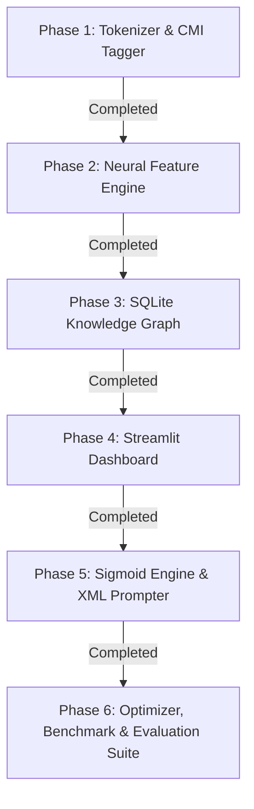

# LAPS Phase-Wise Implementation Plan

This document outlines the engineering implementation plan for building the **LAPS (Linguistic Adaptive Preservation Scoring)** system.

---

## Implementation Phases and Status

---

## Phase 1: Preprocessing and Language ID [COMPLETED]
* **Module:** `src/laps/tokenizer.py` and `src/laps/cmi_detector.py`.
* **Deliverable:** Token-level subword LID tagger and sentence-level CMI code-mixing detector.

## Phase 2: Feature Engineering and Neural Vector Engine [COMPLETED]
* **Module:** `src/laps/feature_extractor.py`.
* **Deliverable:** 6-vector feature extractor utilizing `SentenceTransformer("all-MiniLM-L6-v2")` embeddings and `difflib` fuzzy typo alignment.

## Phase 3: SQLite Knowledge Graph Engine [COMPLETED]
* **Module:** `scripts/ingest_real_datasets.py` and `src/laps/graph_engine.py`.
* **Deliverable:** Ingested 2,907 nodes and 2,940 edges into high-performance SQLite database (`laps_knowledge_graph.db`).

## Phase 4: LLM Rewriter and Explanation Generator [COMPLETED]
* **Module:** `src/llm/rewriter.py` and `src/llm/explainer.py`.
* **Deliverable:** Constrained prompt builder (OpenAI, Ollama, offline fluent Hinglish-to-English translator) and token explanation generator.

## Phase 5: Sigmoid Soft-Boundary Engine and XML Prompter [COMPLETED]
* **Module:** `src/laps/threshold_engine.py` and `src/llm/rewriter.py`.
* **Deliverable:** Soft sigmoid logistic preservation probability engine with 3 decision zones (PRESERVE, UNCERTAIN, REWRITE), KG naturalness penalties, and graph-enriched XML prompt builder.

## Phase 6: Automated Optimization, Benchmark and Human Eval [COMPLETED]
* **Module:** `scripts/optimize_weights.py`, `scripts/benchmark.py`, `scripts/human_eval_export.py`, `data/evaluation/gold_corpus.json`.
* **Deliverable:** Mathematical weight simplex optimizer, automated evaluation harness (OTER, BLEU, Token F1), 100-sentence gold standard corpus, and double-blind human evaluation CSV exporter.
