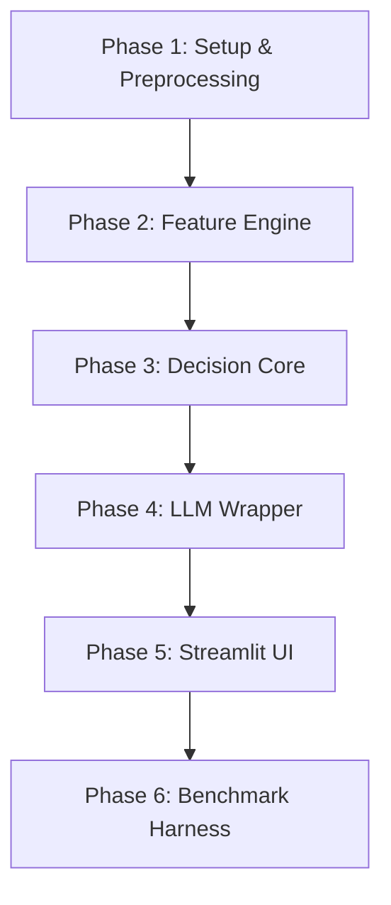

# LAPS Phase-Wise Implementation Plan

This document outlines the step-by-step engineering timeline for building the **LAPS (Linguistic Adaptive Preservation Scoring)** system.

---

## 🛠️ Phases Overview

---

## ⚙️ Phase 1: Project Setup & Preprocessing
* **Objective:** Establish the development environment and load dataset vocabularies.
* **Tasks:**
  1. Create the project directories and setup python virtual environment.
  2. Install basic requirements (`streamlit`, `fastapi`, `transformers`, `spacy`, `torch`, `sentence-transformers`).
  3. Set up the `data/vocabulary/` dictionaries containing baseline borrowing frequencies and technical words.
  4. Write the mock evaluation inputs inside `data/sample_sentences.json`.

---

## 🔬 Phase 2: Feature Engineering Engine (`src/laps/`)
* **Objective:** Implement modular extraction scripts for all 6 scoring components.
* **Tasks:**
  1. **`tokenizer.py`**: Write the bilingual word parser. Implement character-level/substring patterns to detect candidate transliterated borrows (e.g. English words written in Devanagari or Latin script).
  2. **`feature_extractor.py`**:
     * **BF:** Parse frequency indices.
     * **DS:** Load `sentence-transformers` and compute cosine similarity with domain keywords.
     * **SI:** Implement semantic drift calculations.
     * **CC:** Evaluate neighboring sliding-window tokens.

---

## 🧠 Phase 3: Scoring & Threshold Engine (`src/laps/`)
* **Objective:** Assemble features into the LAPS score and implement boundary threshold rules.
* **Tasks:**
  1. **`scorer.py`**: Create the weighted scoring loop. Ensure weights are easily configurable via a YAML or JSON settings file.
  2. **`threshold_engine.py`**: Write the register mapping class. Map labels (`casual`, `business`, `academic`) to different scalar thresholds ($\theta$).
  3. Validate core logic using pytest scripts under `tests/`.

---

## 🔗 Phase 4: LLM Rewriting Connector (`src/llm/`)
* **Objective:** Integrate LAPS outputs with generative model contexts.
* **Tasks:**
  1. **`prompt_builder.py`**: Write templates converting preserved tokens into explicit constraint rules:
     * *Example:* "Rewrite the following Hinglish sentence into formal English but do NOT translate the following words: `[meeting, client]`."
  2. **`rewriter.py`**: Setup connection wrappers for OpenAI API, local Ollama (Llama 3/Qwen), or HuggingFace endpoints.
  3. **`explainer.py`**: Format token calculations into clean, human-readable justification tables.

---

## 🖥️ Phase 5: Streamlit Web UI (`app.py`)
* **Objective:** Launch the user-facing evaluation dashboard.
* **Tasks:**
  1. Design the web UI structure (Sidebar for thresholds, Main Area for input, Scorer visualizer tabs).
  2. Hook Streamlit inputs directly to the `pipeline.py` execution pipeline.
  3. Create interactive score charts using `plotly` or Streamlit bar charts.

---

## 📈 Phase 6: Automated Benchmarking Loop
* **Objective:** Perform automated experiments over baseline translators.
* **Tasks:**
  1. Write evaluation runner scripts that load benchmark datasets.
  2. Integrate standard scoring packages (`sacrebleu`, `bert-score`).
  3. Run evaluation passes comparing LAPS outputs with raw, unconstrained LLM translations and generate final statistics tables.
