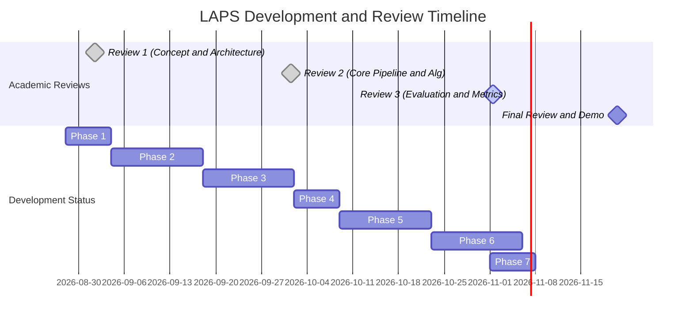

# LAPS Project Roadmap

This document outlines the complete 12-week timeline and milestone strategy for **LAPS (Linguistic Adaptive Preservation Scoring)**.

---

## Academic Milestone Alignment and Current Progress

---

## Weekly Timeline Breakdown

### Week 1-2: Preprocessing, LID and Baselines [COMPLETED]
* **Status:** Completed.
* **Deliverables:** Built `tokenizer.py` with subword/phonetic Hindi language identification (LID) and sentence-level CMI classifier (`cmi_detector.py`).

### Week 3-4: Feature Extraction Engine and Neural Embeddings [COMPLETED]
* **Status:** Completed.
* **Deliverables:** Built `feature_extractor.py` integrating `sentence-transformers` (`all-MiniLM-L6-v2`) zero-shot vector embeddings and fuzzy typo matching (`difflib`).

### Week 5-6: Production Knowledge Graph and Adaptive Thresholds [COMPLETED]
* **Status:** Completed.
* **Deliverables:** Ingested `wordfreq` Zipf frequencies into **2,907-Node, 2,940-Edge SQLite Knowledge Graph (`laps_knowledge_graph.db`)**. Built dynamic threshold engine (`threshold_engine.py`) and Streamlit web dashboard (`app.py`).

### Week 7-8: Sigmoid Probability Engine and XML Prompter [COMPLETED]
* **Status:** Completed.
* **Deliverables:** Implemented Soft Sigmoid Logistic Preservation Probability engine ($P(\text{Preserve} \mid t)$), KG ego-density scoring, and Graph-Enriched XML Prompt Generator.

### Week 9-10: Automated Weight Optimization and Benchmarking [COMPLETED]
* **Status:** Completed.
* **Deliverables:** Implemented `optimize_weights.py` for weight vector tuning ($\mathbf{w}^*$). Built automated benchmark harness (`benchmark.py`) calculating OTER, BLEU, and Token F1.

### Week 11-12: Gold Corpus Expansion and Human Evaluation Suite [COMPLETED]
* **Status:** Completed.
* **Deliverables:** Expanded `gold_corpus.json` to 100 balanced sentences with negative labels, and built `human_eval_export.py` for 3-rater double-blind evaluation studies.
