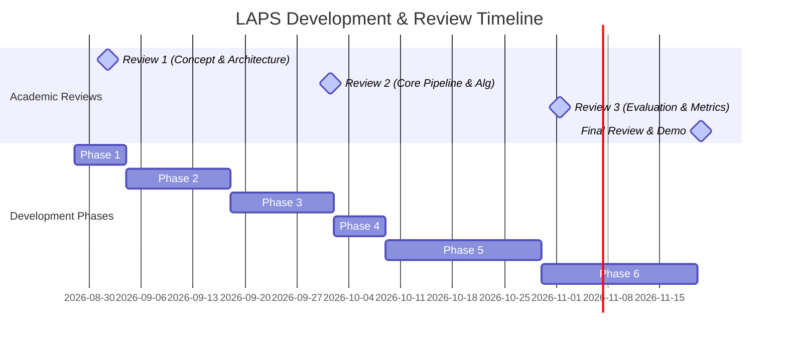

# LAPS Project Roadmap

This document outlines the complete 12-week timeline and milestone strategy for **LAPS (Linguistic Adaptive Preservation Scoring)**.

---

## 📅 Academic Milestone Alignment

---

## 🛠️ Weekly Timeline Breakdown

### **Week 1-2: Preprocessing, Data Collection & Baselines**
* **Goal:** Set up target data schemas and baseline translation models.
* **Tasks:**
  * Collect public code-mixed Hinglish corpora (e.g., LinCE, GLUECoS, Hinglish-to-English translation benchmarks).
  * Build language identification (LID) helpers using pre-trained token classifiers.
  * Establish baseline output sequences using direct LLM prompting (Zero-shot, Few-shot) and NMT models (e.g., IndicTrans2).

### **Week 3-4: Feature Extraction Engine**
* **Goal:** Implement the mathematical scoring features.
* **Tasks:**
  * Implement **Borrowing Frequency (BF)** extraction via frequency tables/lexicons.
  * Implement **Domain Specificity (DS)** checks using domain-specific keyword registries (Tech, Finance, Medical).
  * Implement **Semantic Importance (SI)** vectorization to quantify translation drift.
  * Implement **Context Consistency (CC)** analyzing neighboring tokens.
  * Code core tests for the extraction pipeline.

### **Week 5-6: LAPS Scoring & Threshold Tuning**
* **Goal:** Connect features into a single decision loop.
* **Tasks:**
  * Define the unified weight vector configuration.
  * Code the **Adaptive Threshold Engine** to adjust boundaries depending on formal/informal registers.
  * Create mock configurations for Business, Academic, Social Media, and Casual thresholds.

### **Week 7-8: LLM Integration & Constraint Builder**
* **Goal:** Construct constrained prompt contexts and fetch output rewrites.
* **Tasks:**
  * Build the structured prompt templates containing the source sentence and hard preservation constraints.
  * Hook up the local/API model client wrappers (Ollama/Llama/Qwen/GPT).
  * Implement the explanation generator that formats the reason graph for why tokens were kept/translated.

### **Week 9-10: Experiments & Metrics Benchmark**
* **Goal:** Evaluate performance quantitatively.
* **Tasks:**
  * Execute run scripts over target evaluation sets.
  * Calculate BLEU, COMET, BERTScore, and Over-Translation Error Rates (OTER).
  * Compile comparative matrices against baselines.
  * Perform human evaluation surveys on naturalness and explanation reliability.

### **Week 11-12: Documentation, Research Paper & Patent Drafts**
* **Goal:** Wrap up academic/legal deliverables.
* **Tasks:**
  * Finalize the Streamlit web demo UI.
  * Format the final Scopus/IEEE LaTeX paper structure.
  * Draft the provisional patent specification document.
  * Deliver final project demonstration artifacts.
